[English](SCREENS.md) | 日本語 | [简体中文](SCREENS.zh-CN.md)

# Expert Atlas: 画面説明

コントロールパネルの画面を 1 つずつ、画像つきで説明します。各部分が何を示し、各ボタンが何をするかを書きます。
機能の目的は `FEATURES.ja.md`、操作の細かい決まりは `PANEL-GUIDE.ja.md` にあります。

画像はテスト用のサーバーにつないだパネルで撮りました。メモリ・速さ・トークン数・温度などの数字は例で、実測ではありません。
実際のノードでは、そのノードの値が出ます。ノードの名前は node-0、node-1 のように表しています。

パネルは `http://<1 台目のノード>:8010/panel` で開きます。`READY` が表示するダッシュボードの住所です (`QUICKSTART.ja.md`)。
キーはないので、ノードは閉じたネットワークに置いてください。

## 画面の順番

| 手順 | 画面 | 出るとき |
|---|---|---|
| 1 | ノード確認 | ノードが登録されていない間。手順バーから開いたとき |
| 2 | 起動設定 | エンジンが止まっている間 |
| 3 | 起動 | エンジンが読み込んでいる間 |
| › | 稼働 | エンジンが動いている間 |

画面は自動で切り替わります。見出しからは、エンジン設定と起動の流れの 2 つの画面も開けます。表示設定は、どの画面でも下の引き出しにあります。

見出しにあるもの:

- **手順バー** (タイトルの下。エンジンが動く前だけ): 手順ごとの状態を出します。たとえば `RING-4`、`3.50 bit · 起動できます`。押すとその画面に移ります。
- タイトルの横の **RING** か **SWITCH**: ノードのつなぎ方です。
- **起動の流れ**: 手順を 1 枚にまとめた画面です (下)。
- **起動** (動作中は **推論**) | **エンジン設定**: メインの画面と、再起動が必要な設定を切り替えます。
- **非表示** / **表示**: サークルを消す、または戻します。

## 1. ノード確認: リング

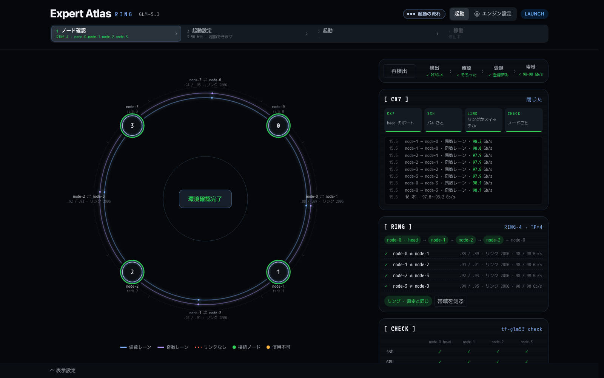

ノードが登録されていない間、パネルはここで開きます。リングでは、開いた時点で head の ConnectX-7 (CX7) の配線を読みます。

- **右上のボタン** (検出、ノード確認、終わった後は再検出) で、次の手順を順に進めます。
  - **検出**: LLDP で配線をノードからノードへたどり、リングが閉じるまで調べます。
  - **確認**: 全ノードで `tf-glm53 check` を実行します。パッケージが無いノードには配ります。
  - **登録**: ノードをリングの順に `glm53.nodes.conf` に書きます。
  - **帯域**: レーンごとに両方向の帯域を測ります。

  各手順には ✓ か ✗ と短い結果が出ます。失敗した手順で止まり、理由を出します。
- **サークル** はリングを描きます。各ノードには名前と rank が出ます。1 本のリンクには 2 本のレーン (内側が偶数レーン、外側が奇数レーン) があり、
  2 つのサブネットとリンク速度を添えます。つながっていないリンクは赤い破線です。全部の手順が通ると、中央に「環境確認完了」が出ます。
- **[ CX7 ]**: 4 つの段階 (head のポート、/24 ごとの SSH、リングかスイッチか、ノードごと) と、各段階で見つけたもののログです。
  帯域を測った後は、レーンごとの Gb/s が並びます。
- **[ RING ]**: head から見たリングの順番と、リンクごとのサブネット、リンク速度、測った Gb/s です。**帯域を測る** でもう一度測ります。
- **[ CHECK ]**: `tf-glm53 check` の結果です (下)。

全部の手順が通ると、パネルは起動設定に進みます。

### [ CHECK ]

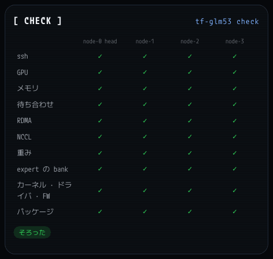

列がノード、行が確認の項目です: ssh、GPU、メモリ、待ち合わせ、RDMA、NCCL、重み、expert の bank、カーネル・ドライバ・ファームウェア、パッケージ。
✗ には、何が悪く、何をすればよいかが出ます。

## 1. ノード確認: スイッチ

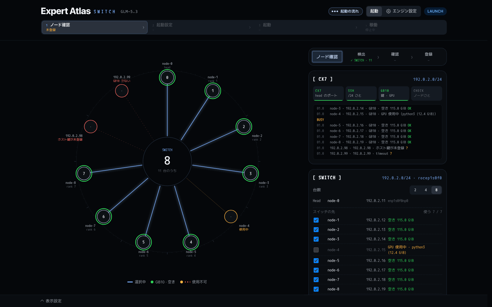

スイッチでは、head が自分の ConnectX-7 の /24 でノードを探します。ssh に答えるアドレスが候補です。

- **サークル** は、見つけたアドレスをスイッチの周りに並べます。緑は空いている GB10 です。選んだノードは中央と線でつながります。
  オレンジは使用中 (GPU が動いている) です。赤は使えないもの (GB10 でない、ホスト鍵が未登録、応答なし) です。
  中央には、見つけた台数のうち何台を選んだかが出ます。
- **[ CX7 ]**: アドレスごとに 1 行。名前、空きメモリ、OK・BUSY・? を出します。
- **[ SWITCH ]**: 使う台数、head、見つけたノードの一覧とチェックです。使用中のノードはチェックできません。
- **ノード確認** を押すと、チェックしたノードを確かめて登録します。リングと同じです。スイッチには帯域の手順はありません。

スイッチに他の人のノードもあるときは、先に台数とチェックを選んでから押してください (`PANEL-GUIDE.ja.md` の「ノード確認」)。

## 2. 起動設定

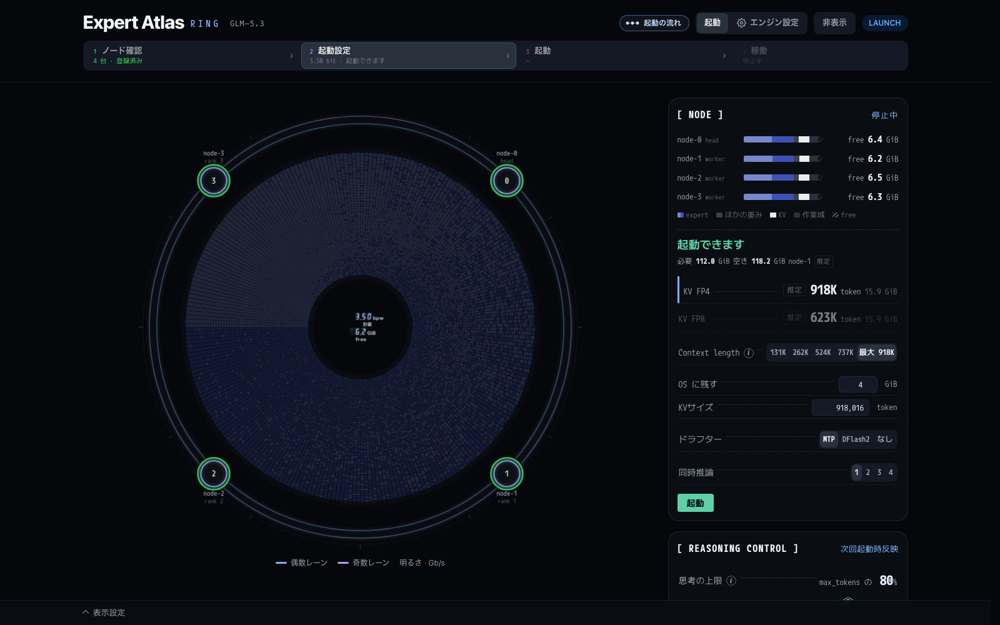

エンジンは止まっています。ここで次の起動の計画を立て、起動を押します。

- **サークル** は計画を示します。1 マスが routed expert 1 つで、全部で 19,200 個です。色が bit 幅です。内側が層 3、外側が層 77 で、1 周が 256 個です。
  リングのレーンでは、周りに 4 台のノードが並びます。
- **中央** には、計画の平均 bit と空きメモリが出ます。
- **右のカード**: [ NODE ]、[ REASONING CONTROL ]、[ WEIGHTS ]、[ BIT ALLOC ]、**expert** (マスを指すと、その expert の層の中の順位、選択の割合、bit、大きさが出ます)。

### [ NODE ]: メモリと起動

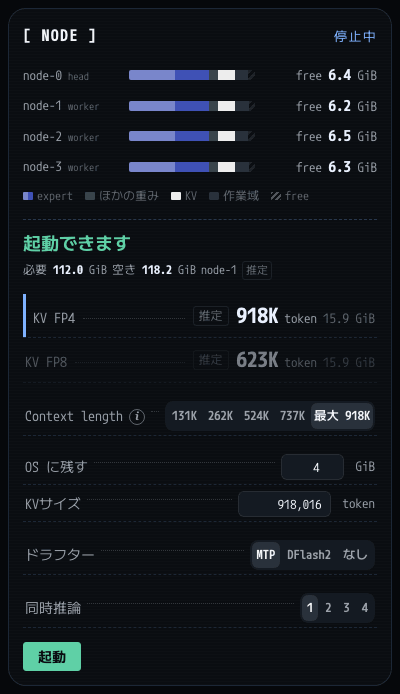

- **ノードごとの棒**: 計画が使うメモリの内訳です。expert、ほかの重み、KV、作業域、free。右は起動後に残る free の GiB です。
- **判定**: 起動できます、起動できます（余裕なし）、メモリ不足 のどれかです。最も空きの少ないノードの、必要な量と空きを添えます。
  「推定」の印は見積もりです。このレーンで、そのドラフターの起動をまだ測っていません。
- **KV FP4 / KV FP8**: それぞれの形式で取れる KV サイズ (トークンと、1 ノードの GiB) です。押した形式を使います。
- **Context length**: 1 回の要求 (prompt と返答の合計) の最長です。サイズか、計画で入る最長の「最大」を選びます。ⓘ で最大の決め方を見られます。
- **OS に残す**: 起動後に各ノードで空けておく GiB です (2〜32)。
- **KVサイズ**: KV キャッシュ全体が持つトークン数です。数字を入れると自分で決められます。
- **ドラフター**: MTP、DFlash2、なし。DFlash2 は、全ノードにモデルがそろうまで灰色です。
- **同時推論**: いっしょに decode する会話の数で、1〜4 です。1 は 1 本ずつ処理します。
- **起動**: 押したあと、8 秒以内に **確定** を押します。

ここで選んだ値は、選んだ時点で `glm53.conf` に書きます。

### [ BIT ALLOC ]: expert ごとの bit

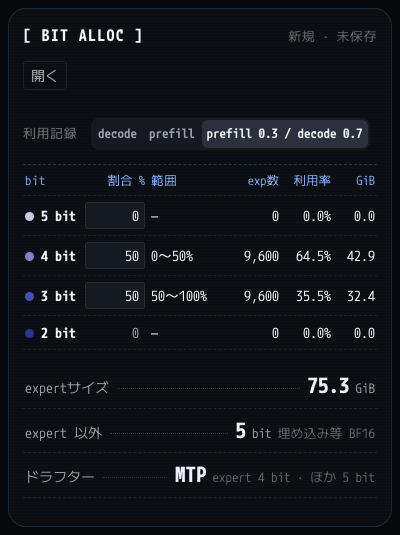

- **見出し**: 計画の名前です。新規 · 未保存、前回の稼働、保存した割り当ての名前のどれかです。
- **開く**: 前回の稼働の割り当てと、保存した割り当てです (下)。
- **利用記録** (decode、prefill、prefill 0.3 / decode 0.7): 利用率の列とサークルの並びが従う回数です。計画の bit は変わりません。
- **表**は幅ごとに 1 行です (5、4、3、2 bit)。割合 % (5・4・3 bit に入力。残りはデータのある一番狭い幅になります)、目盛りの範囲 (5 bit の端から数えます)、
  exp数、利用率 (その幅が選ばれた割合)、GiB。どれかのノードで bank が無い幅は「データなし」になり、割合を入れられません。
- **expertサイズ**: routed expert が使う GiB です。**expert 以外** と **ドラフター**: ほかの重みとドラフターの bit です。

よく使われる expert ほど広い bit になります。割合を入れると新しい計画になります。

### 開く: 保存した割り当て

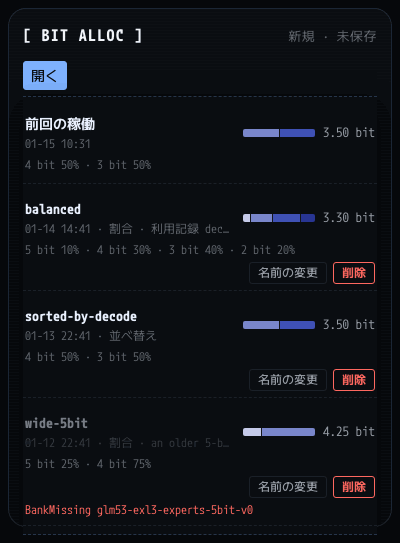

前回の稼働の割り当てと、保存した割り当ての一覧です。いつ・どう作ったか、割合、平均 bit が出ます。押すと、その割り当てが bit そのままで計画になります。
保存したものには **名前の変更** と **削除** (もう一度押して確定) があります。このレーンに無い bank を使う割り当ては開けません。
理由が赤で出ます (この例では `BankMissing`)。

### [ WEIGHTS ]: ファイルの場所

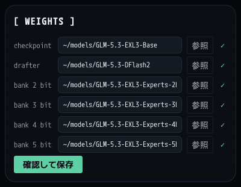

チェックポイント、ドラフター (DFlash2)、2・3・4・5 bit の bank が 1 行ずつです。どれもディレクトリで、全ノードで同じパスに置きます。
**参照** で head のディレクトリを選べます。✓ は全ノードにあることを示します。**確認して保存** は全ノードを確かめ、通った行を保存します。
チェックポイントと 3 bit の bank は必須です。無いと行が赤くなり、起動は押せません。

### 起動前の [ REASONING CONTROL ]

稼働パネルと同じカードです (4 章)。エンジンが止まっている間は見出しの札が「次回起動時反映」になり、変えた値は次の起動のために `glm53.conf` に保存します。

### 起動の流れ

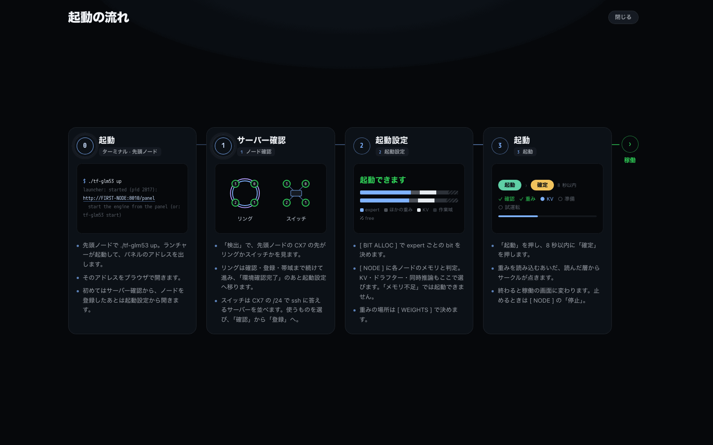

見出しの **起動の流れ** で開きます (手順バーが出ている間)。手順を 1 枚に並べます: 0 head でランチャーを起動、1 ノード確認、2 起動設定、3 起動、そして稼働。
**閉じる** か Escape で戻ります。

## 3. 起動

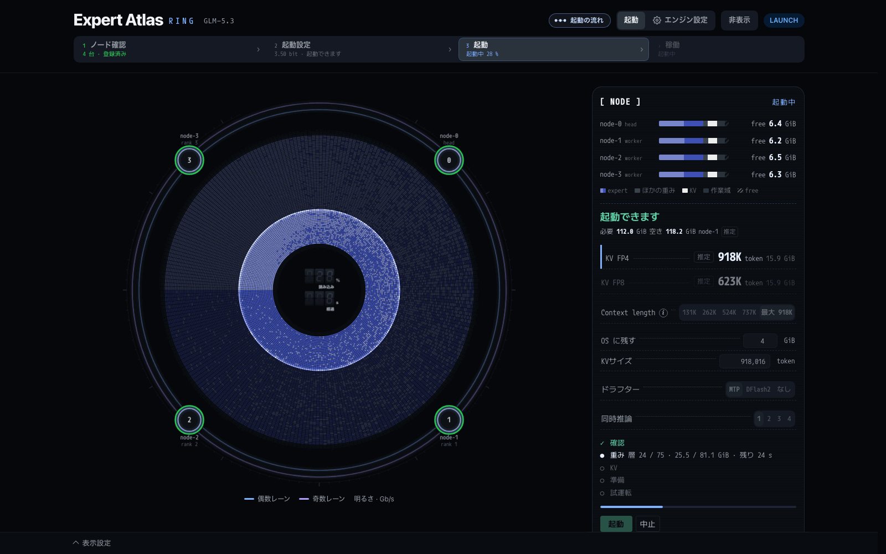

起動と確定を押すと、手順バーに「起動中」と割合が出ます。

- **サークル** は、読み込んだ層から内側から埋まっていきます。エンジンの実際の読み込みの進みです。中央には読み込みの割合と経過秒数が出ます。
- **[ NODE ]** には段階が並びます: 確認、重み (75 層のうち何層、GiB、残り時間)、KV、準備、試運転。下に進み具合の棒があります。**中止** で起動をやめます。

準備ができると、サークルの上に「起動完了」と台数、かかった秒数が出ます。そのあと稼働パネルに切り替わります。

## 4. 稼働パネル

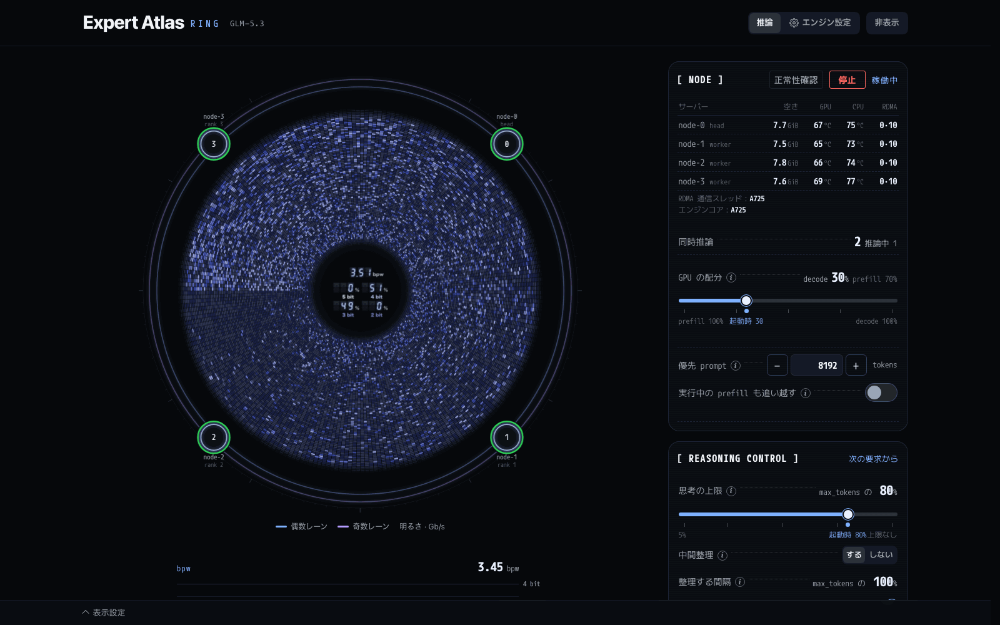

エンジンが動いています。左のサークルは、モデルがいま何をしているかを示します。右のカードには、ノードと、動作中に変えられる設定があります。
サークルの下に bpw のグラフ、速さ、KV pool があります。

### サークル

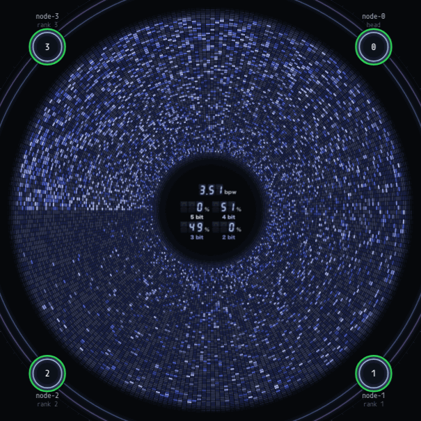

- **decode**: トークンごとにモデルが選んだ expert が光って消えます。本物です (エンジンの選択の記録)。
- **prefill**: 内側から外へ広がる輪が、いま計算している層を示します (prompt の進みからの見積もり)。マスの点滅は演出です。
- **並び**: prompt の計算中は番号順です。返答が始まると使用順 (よく使われる順、9 時から) に変わります。
- **外周**: prompt の計算中は prefill の進み (本物) です。decode 中は返答の文字を外周に回すこともできます (表示設定の 文字)。
- **中央**: bpw (選ばれた expert の bit の平均) と、幅ごとの選択の割合です。
- **思考中と回答中**: 返答が思考している間は外周の帯がテーマの一方の色になり、12 時の上に THINKING と token 数が出ます。回答の
  間はもう一方の色と ANSWER です。切り替わると、新しい色が 12 時から一周します。
- **リングのレーン** では、サークルの周りに 4 台のノードが並び、リングのレーンが通信量に合わせて光ります。

### bpw と速さ

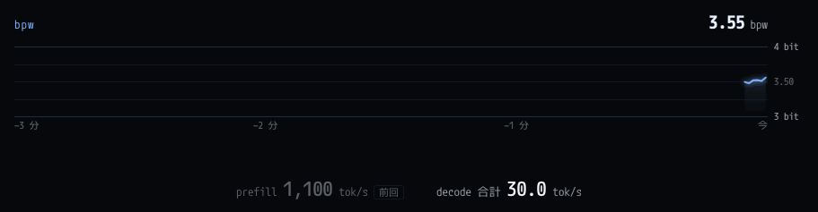

- **bpw**: 選ばれた expert の bit の平均の、直近 3 分の推移です。
- **prefill** と **decode** の毎秒トークン数です。同時に複数の会話があるときは、decode は全部の合計です。

### 稼働中の [ NODE ]

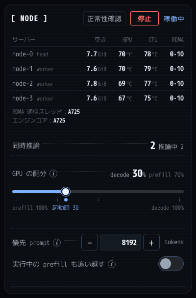

- **正常性確認**: エンジンに約 1,000 トークンの要求を 1 本送り、答えを判定します (下)。
- **停止**: エンジンを止めます (下)。
- **サーバー**: ノードごとに head か worker、空きメモリ、GPU と CPU の温度です。5 秒ごとに読みます。RDMA の列は、各ノードの 2 本の
  RoCE 通信スレッドが動く CPU です (たとえば 0·10)。
- **RDMA 通信スレッド** と **エンジンコア**: 通信スレッドが動くコア (A725、X925、または OS) と、エンジンが動くコア (A725、
  または OS) です。
- **同時推論**: エンジンがいっしょに decode している会話の数と、推論中の要求の数です。
- **GPU の配分** (同時推論が 2 以上のとき): prompt の計算と、decode 中の会話が重なる間の GPU の時間の分け方です。prefill 100% から
  decode 100% まで、5% 刻みです。点は起動時の値です。
- **優先 prompt**: 新しく計算するトークンがこの数以下の prompt は、長い prompt より先に入ります。0 で無効です。
- **実行中の prefill も追い越す**: 実行中の長い prefill も、優先 prompt に順番を譲ります。

ⓘ を押すと、その行の説明が出ます。

### 正常性確認

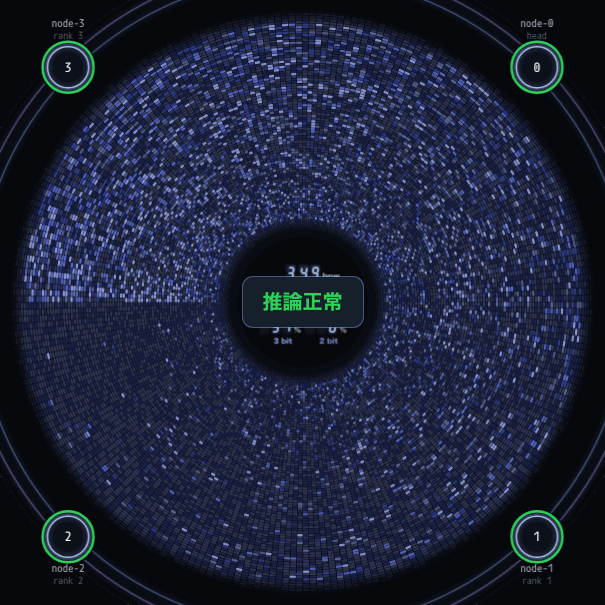

答えが正しければ、中央に **推論正常** が数秒出ます。**推論異常** はボタンの下に理由と一緒に残り、次に押すかエンジンが止まるまで消えません。
長い推論の後ろでは順番を待ちます (最大 600 秒)。

### [ REASONING CONTROL ]

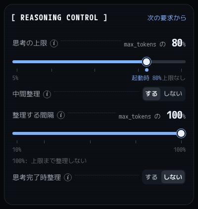

思考の設定を、エンジンを動かしたまま変えます。変えた後に始まる要求から効きます (札は「次の要求から」)。`glm53.conf` にも書くので、次の起動でも同じ値です。

- **思考の上限**: 各返答の max_tokens の 5%〜100% (上限なし)。点は起動時の値です。
- **中間整理**: する / しない。
- **整理する間隔**: max_tokens の 10%〜100%。100% は上限に来たときだけ整理します。中間整理がしないのときは灰色です。
- **思考完了時整理**: する / しない。

それぞれが何をするかは `FEATURES.ja.md` にあります。

### [ RING ]

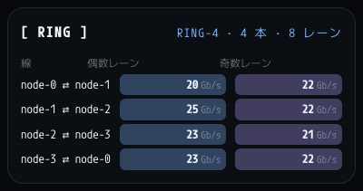

リングのレーンだけに出ます。リンクごとの偶数レーンと奇数レーンの、いまの通信量 (Gb/s) です。約 2 秒ごとに読みます。落ちたレーンは「断」と出ます。

### 稼働中の [ BIT ALLOC ]

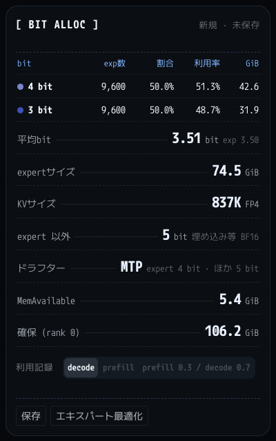

- **見出し**: 起動に使った割り当てです (新しい計画からなら 新規 · 未保存)。
- **表**: 載っている幅ごとに、exp数、割合 (expert 数の割合)、利用率 (この稼働の選択の割合)、GiB。
- **平均bit**: 選ばれた expert の bit の平均です。`exp` は載っている expert の bit の平均です。
- **expertサイズ**、**KVサイズ** (トークンと形式)、**expert 以外**、**ドラフター**、**MemAvailable**、**確保 (rank 0)**。
- **利用記録**: 利用率がどの回数に従うかを選びます。
- **保存**: 載っている bit と利用記録を名前を付けて保存します。**エキスパート最適化**: 下で説明します。

### エキスパート最適化

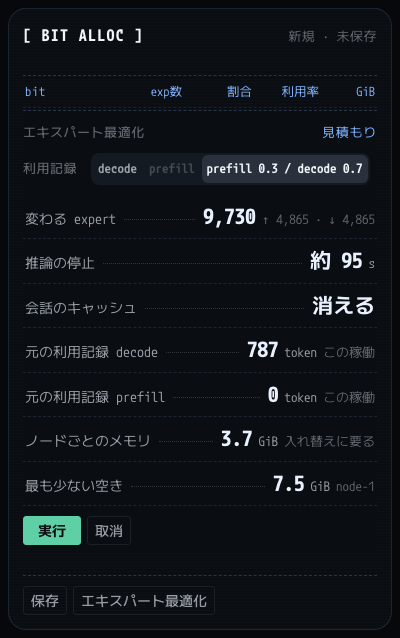

**エキスパート最適化** を押すと、カードの上に見積もりが出ます。

- **変わる expert**: 変わる数と、そのうち bit が上がるもの (↑) と下がるもの (↓) の数です。
- **推論の停止**: 入れ替えで推論が止まるおよその時間です。
- **会話のキャッシュ**: 消える。KV pool に残した会話はなくなります。
- **元の利用記録 decode / prefill**: この稼働で数えたトークン数です。
- **ノードごとのメモリ**: 入れ替えに要る量と、空きが最も少ないノードです。
- **利用記録** で、並べるときに使う回数を選びます。変えると見積もりを取り直します。

**実行** を押すと、推論中と待ちの要求がなくなるまで待ち、層ごとに expert を入れ替えます。**取消** で閉じます。
結果は自動では保存しません。残すときは 保存 を押します。

### KV POOL

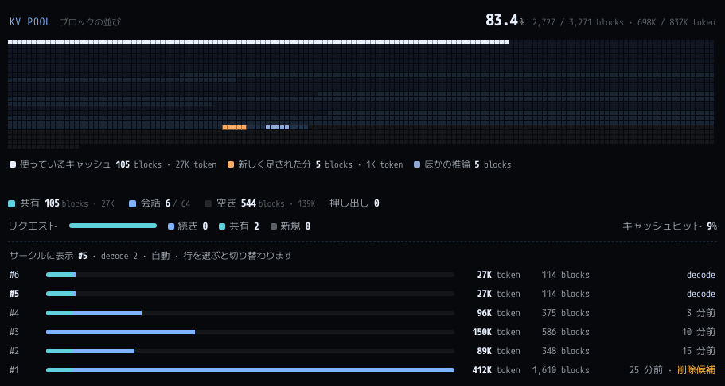

すべての会話が分け合う KV キャッシュです。

- **見出し**: 使っている割合、全ブロックのうち使っている数、トークン数です。
- **地図**: 1 マスが 256 位置の 1 ブロックです。水色が共有の頭、青が残している会話、暗いマスが空きです。その上に、白が実行中の要求が読んでいる
  キャッシュ、オレンジがその要求が足したブロック、青灰色がほかに動いている要求です。
- **共有**: 複数の会話が持つブロックです (共通の system prompt など)。**会話**: 残している会話の数です (64 まで)。**空き** と **押し出し**。
- **リクエスト**: 要求がキャッシュをどう使ったか (続き、共有、新規) と、prompt のうちキャッシュから読んだ割合 (キャッシュヒット) です。
- **会話の一覧**: 1 行が 1 つの会話で、最近使った順です。トークン数、ブロック数、状態が出ます。場所が足りないときは最後の行から
  ブロックを返します (削除候補)。同時に複数の要求があるときは、行を選ぶとサークルがその要求に切り替わります。

### 停止

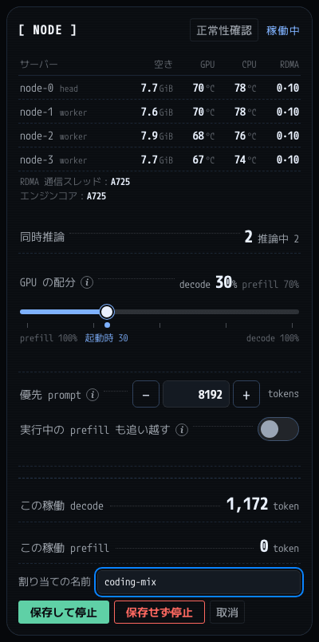

**停止** は先に確かめます。この稼働の decode と prefill のトークン数と、割り当ての名前が出ます。

- **保存して停止**: 載っている bit と利用記録を、その名前で保存してから止めます。
- **保存せず停止**: 何も保存せずに止めます。
- **取消**: エンジンを動かしたままにします。

## エンジン設定

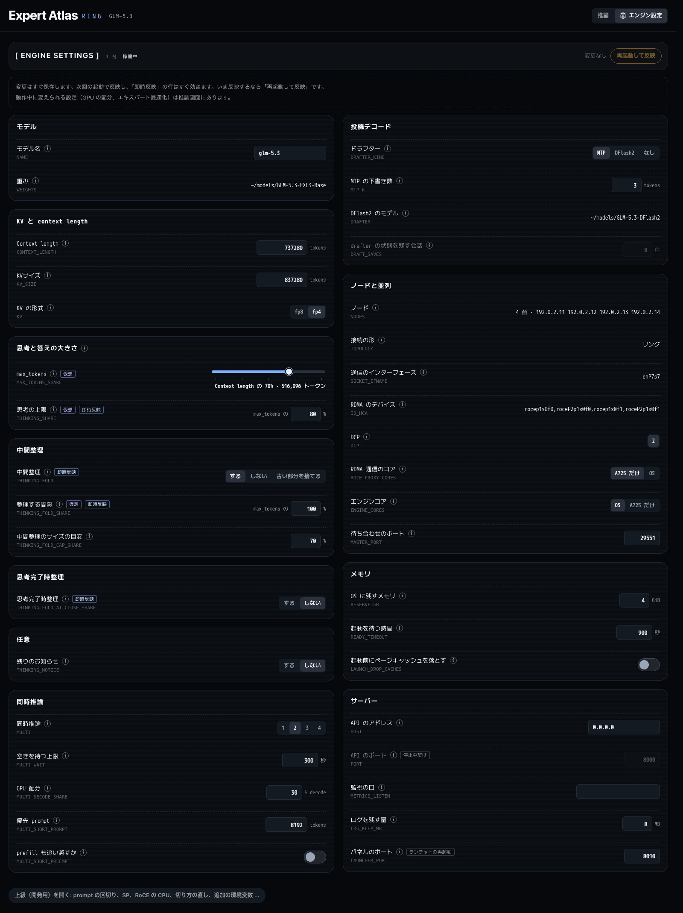

見出しの **エンジン設定** で開きます。再起動が必要な設定で、`glm53.conf` に入ります。

- **見出し**: 台数、エンジンの状態、反映を待っている変更、**再起動して反映** (エンジンが動いている間)。
- **グループ**: モデル、KV と context length、思考と答えの大きさ、中間整理、思考完了時整理、任意、同時推論、投機デコード、ノードと並列、メモリ、サーバー。
- **各行**: 名前、ⓘ、キー (たとえば `CONTEXT_LENGTH`)、値。札は 即時反映、仮想 (書いたトークンの数で数える)、停止中だけ、ランチャーの再起動 です。
- 下の **上級（開発用）**: prompt の区切り、SP、切り方の直し、追加の環境変数などです。

変更はその時点で保存します。次の起動から効き、「即時反映」の行はすぐ効きます。**再起動して反映** はいまエンジンを起動し直します。
その前に、停止と同じく、この稼働の利用記録を保存するかを聞きます。重みとノードはここでは見るだけです。[ WEIGHTS ] とノード確認で変えます。

## 表示設定

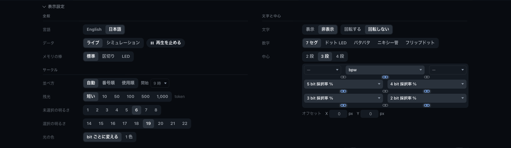

画面下の **表示設定** で開きます。パネルの見た目だけを変え、エンジンは変えません。

- **全般**: 言語 (English / 日本語)、データ (ライブ / シミュレーション と 再生を止める)、メモリの棒の見た目。
- **サークル**: 並べ方、残光 (選ばれた expert が光っている長さ)、未選択と選択の明るさ、光の色 (bit ごとに変える / 1 色)。
- **文字と中心**: 外周の文字、数字の形、中心に出すもの。
- **配色**: 配色のプリセット。
- 下に **既定に戻す** (2 回押す) があります。

設定は head にレーンごとに保存するので、どのブラウザで開いても同じパネルになります。

## サークルを隠した画面

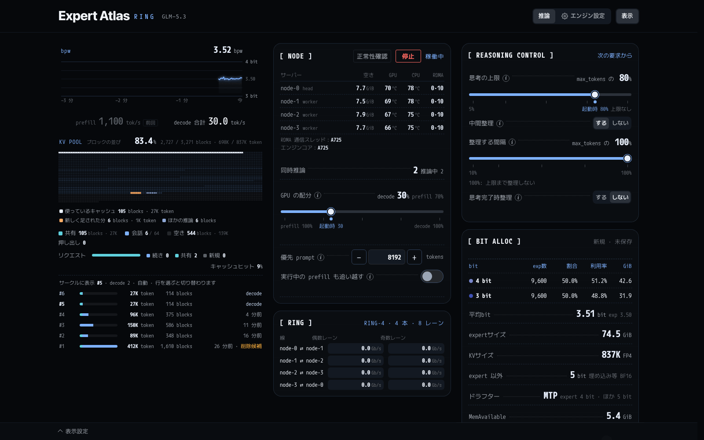

見出しの **非表示** でサークルを消し、描画も止めます。カードは列に並びます: bpw のグラフ・速さ・KV pool、[ NODE ] と [ RING ]、
[ REASONING CONTROL ] と [ BIT ALLOC ]。**表示** で戻ります。レーンがこの選択を覚えます。起動画面でも使えます。
