English | [日本語](SCREENS.ja.md) | [简体中文](SCREENS.zh-CN.md)

# Expert Atlas: the screens

This page shows every screen of the control panel, one section a screen, with a picture of each and what its parts
are. `FEATURES.md` says what each feature is for. `PANEL-GUIDE.md` gives every control in detail.

The pictures were taken from the panel against a test server. Their numbers (memory, speeds, tokens, temperatures)
are examples, not measurements: your nodes show their own. The nodes are named node-0, node-1 and so on.

The panel is at `http://<first node>:8010/panel`, the dashboard address that `READY` prints (`QUICKSTART.md`). It has no
key: keep the nodes on a closed network.

## The screens in order

| Step | Screen | When it shows |
|---|---|---|
| 1 | Node check | While no nodes are registered, and whenever you open it from the step bar |
| 2 | Launch settings | While the engine is stopped |
| 3 | Start | While the engine loads |
| › | Live panel | While the engine runs |

The panel moves between them by itself. Two more screens open from the header: the engine settings and the startup
flow. The display settings are a drawer at the bottom of every screen.

The header holds:

- **The step bar** (under the title, before the engine runs): each step with its state, for example `RING-4` or
  `3.50 bit · Can start`. Press a step to open its screen.
- **RING** or **SWITCH** beside the title: how the nodes are cabled.
- **Startup flow**: a one-page summary of the steps (below).
- **Launch** (Inference while the engine runs) | **Engine settings**: switches between the main screen and the settings
  that need a restart.
- **Hide** / **Show**: takes the circle off the screen or brings it back.

## 1. Node check: a ring

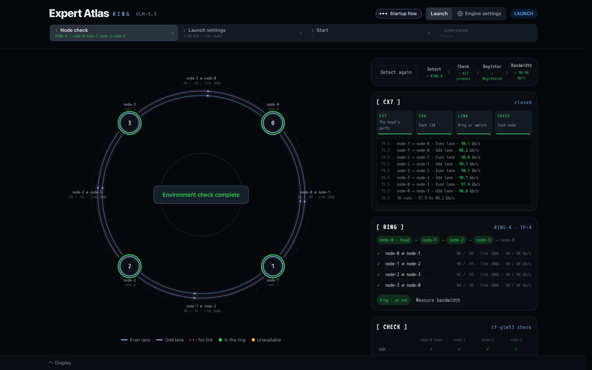

The panel opens here while no nodes are registered. On a ring it reads the head node's ConnectX-7 (CX7) cables as it
opens.

- **The button** at the top right (Detect, Check the nodes, or Detect again once done) runs every step in turn:
  - **Detect**: follows the cables from node to node over LLDP until the ring closes.
  - **Check**: runs `tf-glm53 check` on every node, and copies the package where it is missing.
  - **Register**: writes the nodes, in ring order, to `glm53.nodes.conf`.
  - **Bandwidth**: measures each lane in both directions.

  Each step shows ✓ or ✗ and a short result. When a step fails, the run stops there and says why.
- **The circle** draws the ring. Each node shows its name and rank. Each link has two lanes (even lane inside, odd lane
  outside), with its two subnets and its link speed. A missing link is a dashed red line. "Environment check complete"
  shows in the centre when every step passed.
- **[ CX7 ]**: the four stages (the head's ports, SSH on each /24, ring or switch, each node) and a log of what each
  stage found. After the bandwidth step, the log lists each lane's Gb/s.
- **[ RING ]**: the ring order from the head, and each link with its subnets, link speed and measured Gb/s. **Measure
  bandwidth** measures again.
- **[ CHECK ]**: the result of `tf-glm53 check` (below).

When every step passes, the panel goes on to the launch settings.

### [ CHECK ]

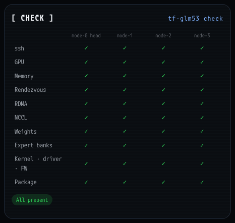

One column a node, one row a check: ssh, GPU, memory, rendezvous, RDMA, NCCL, the weights, the expert banks, the kernel,
driver and firmware, and the package. A ✗ says what is wrong and what to do.

## 1. Node check: a switch

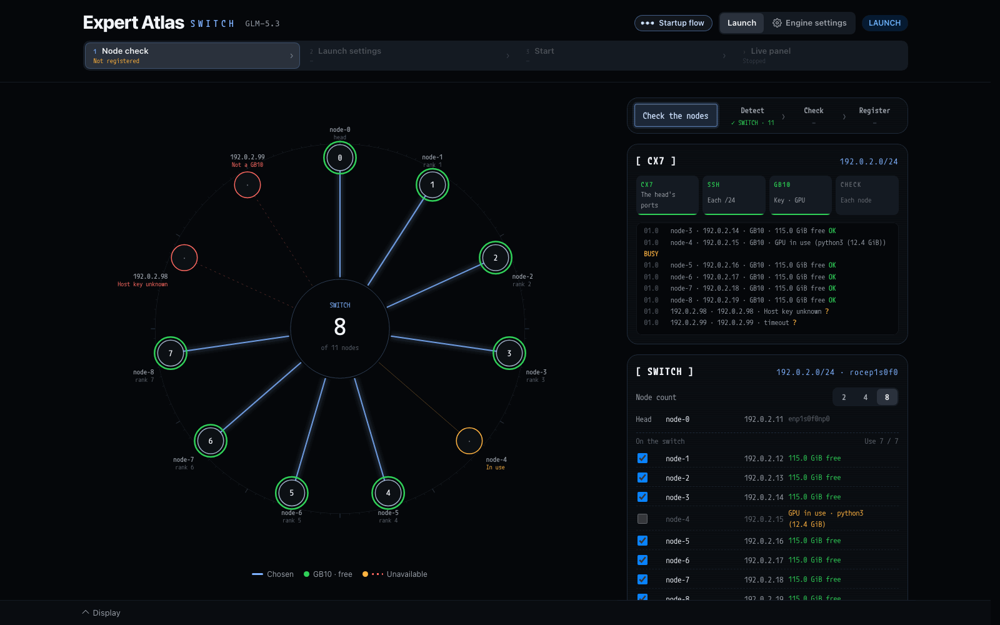

On a switch the head looks for nodes on its ConnectX-7 /24: the addresses that answer ssh.

- **The circle** shows each address found around the switch. A green node is a free GB10. A line joins each chosen node
  to the centre. Orange is in use (its GPU is busy). Red cannot be used (not a GB10, host key not known, or no answer).
  The centre shows how many nodes are chosen of how many were found.
- **[ CX7 ]**: one log line an address, with its name, free memory and OK, BUSY or ?.
- **[ SWITCH ]**: the node count to use, the head, and every node found with a tick. A busy node cannot be ticked.
- **Check the nodes** checks the ticked nodes and registers them, as on a ring. A switch has no bandwidth step.

If the switch also has other people's nodes, choose the node count and the ticks first, then press the button
(`PANEL-GUIDE.md`, "Node check").

## 2. Launch settings

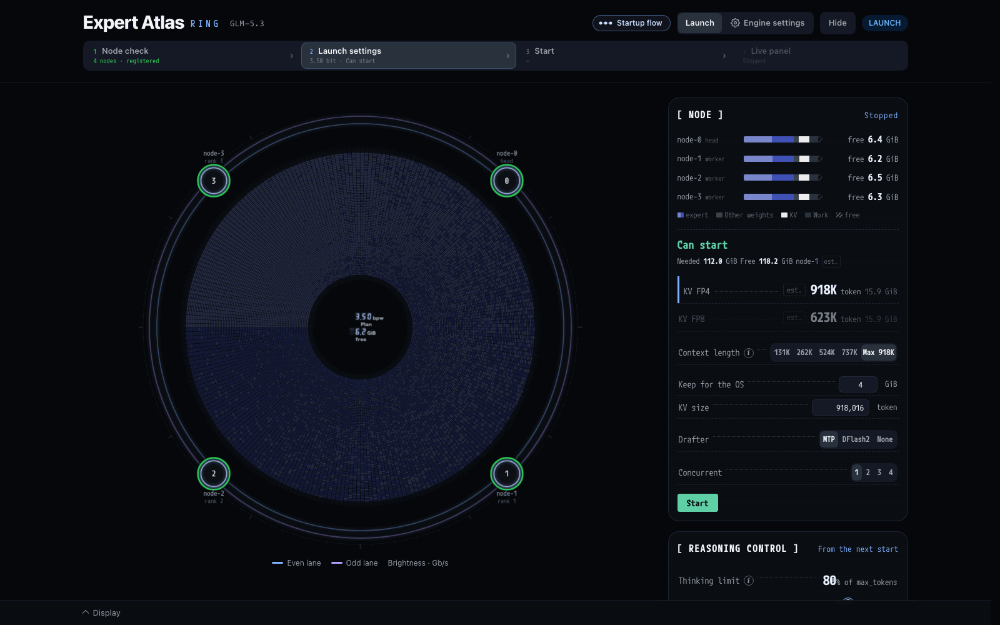

The engine is stopped. Here you plan the next start and press Start.

- **The circle** shows the plan: each cell is one of the 19,200 routed experts, its colour its bits. Layer 3 is inside
  and layer 77 outside, 256 experts a ring. On a ring lane the four nodes stand round it.
- **The centre** shows the plan's mean bits and the free memory.
- **The cards** on the right: [ NODE ], [ REASONING CONTROL ], [ WEIGHTS ], [ BIT ALLOC ], and **expert** (point at a
  cell to see that expert's rank in its layer, share of picks, bits and size).

### [ NODE ]: memory and the start

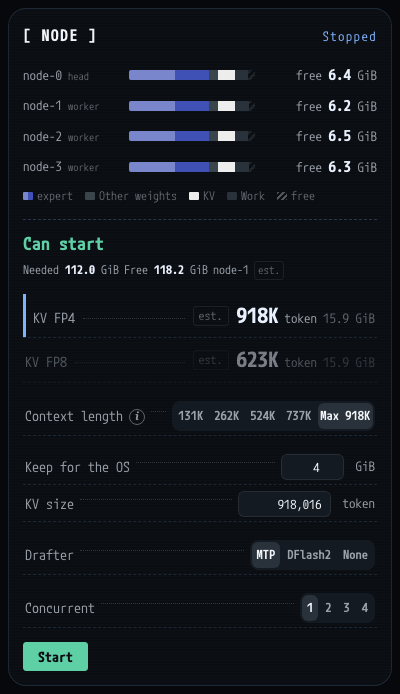

- **One bar a node**: the memory the plan takes, in parts: expert, Other weights, KV, Work and free. On the right, the
  free GiB left after the start.
- **The verdict**: Can start, Can start (little room) or Not enough memory, with the memory needed and free on the
  tightest node. `est.` marks an estimate: the launcher has not yet measured a start with this drafter on this lane.
- **KV FP4 / KV FP8**: the KV size each format would give, in tokens and GiB a node. Press one to choose it.
- **Context length**: the longest request (prompt and reply). Choose a size, or Max for the most the plan leaves room
  for. The ⓘ explains how Max is found.
- **Keep for the OS**: the GiB each node keeps free after the start (2 to 32).
- **KV size**: the tokens the whole KV cache holds. Type a number to set it yourself.
- **Drafter**: MTP, DFlash2 or None. DFlash2 is greyed until every node has its model.
- **Concurrent**: how many conversations are decoded together, 1 to 4. 1 runs one request at a time.
- **Start**: press it, then press Confirm within 8 seconds.

Every choice here is written to `glm53.conf` as you make it.

### [ BIT ALLOC ]: the bits of each expert

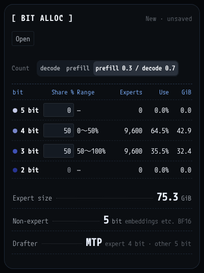

- **The head** names the plan: New · unsaved, the last run, or a saved allocation's name.
- **Open**: the last run's allocation and the saved ones (below).
- **Count** (decode, prefill, prefill 0.3 / decode 0.7): the counts the Use column and the circle's order follow. It
  does not change the plan's bits.
- **The table**, one row a width (5, 4, 3, 2 bit): Share % (type it for 5, 4 and 3 bit; the narrowest width with data
  takes the rest), the range on the scale (it starts at the 5-bit end), Experts, Use (that width's share of the picks)
  and GiB. A width whose bank is missing on a node shows No data and takes no share.
- **Expert size**: the GiB the routed experts take. **Non-expert** and **Drafter**: the bits of the other weights and
  of the drafter.

The most used experts get the widest bits. Typing a share makes a new plan.

### Open: saved allocations

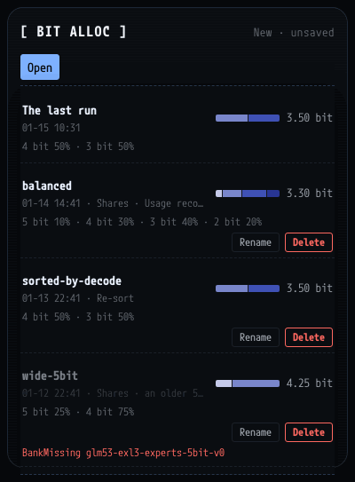

The last run's allocation and each saved one, with when and how it was made, its shares and its mean bits. Press one
to make it the plan, bit for bit. **Rename** and **Delete** (press it twice) work on the saved ones. An allocation
that needs a bank this lane does not have cannot be opened; the reason shows in red (here `BankMissing`).

### [ WEIGHTS ]: where the files are

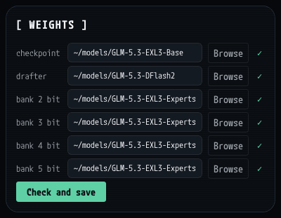

One row each for the checkpoint, the drafter (DFlash2) and the 2, 3, 4 and 5-bit banks. Each is a directory with the
same path on every node. **Browse** picks a directory on the head. A ✓ means every node has it. **Check and save**
checks every node and saves the rows once they pass. The checkpoint and the 3-bit bank are required: without them the
row is red and Start stays off.

### [ REASONING CONTROL ] before the start

The same card as on the live panel (section 4). While the engine is stopped its tag says From the next start: a
change is saved in `glm53.conf` for the next start.

### Startup flow

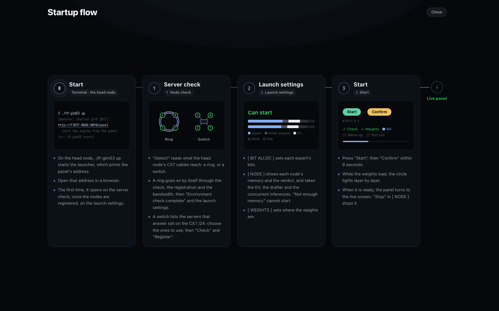

**Startup flow** in the header opens this page while the step bar shows. It puts the steps on one page: 0 start the
launcher on the head node, 1 node check, 2 launch settings, 3 start, then the live panel. **Close** or Escape goes back.

## 3. Start

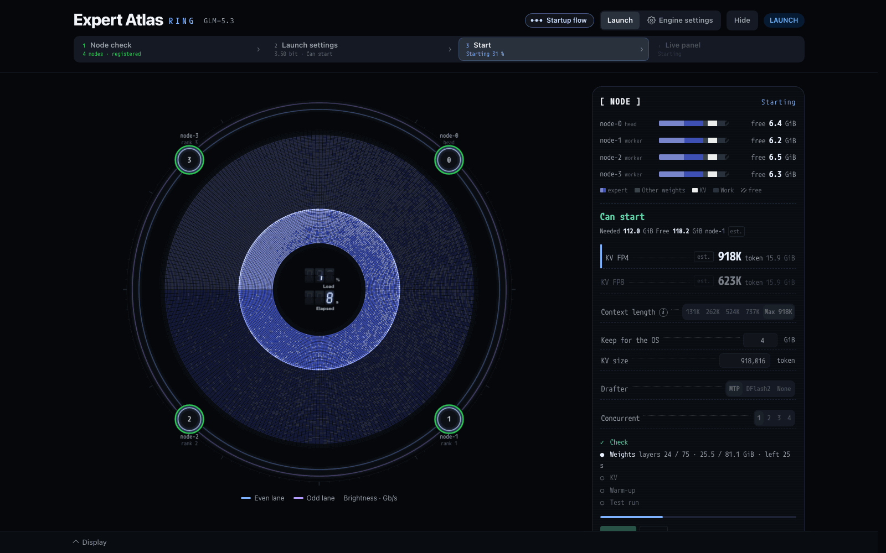

After Start and Confirm the step bar shows Starting and a percentage.

- **The circle** fills from the inside as each layer loads. This follows the engine's real load progress. The centre
  shows the load percentage and the seconds elapsed.
- **[ NODE ]** lists the stages: Check, Weights (layers loaded of 75, the GiB and the time left), KV, Warm-up and Test
  run, with a progress bar. **Abort** stops the start.

When the engine is ready, "Start complete" shows over the circle with the node count and the seconds the start took.
Then the page turns into the live panel.

## 4. Live panel

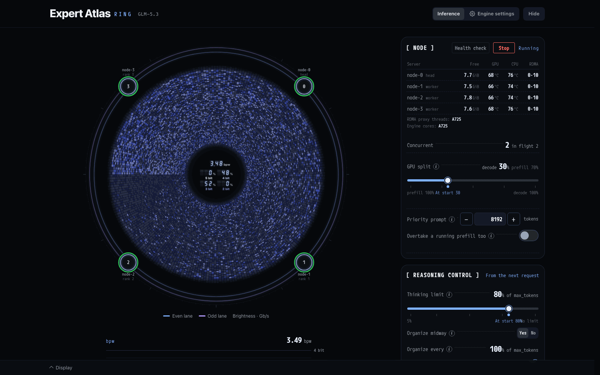

The engine runs. The circle on the left shows what the model does now. The cards on the right show the nodes and the
settings you can change while it runs. Below the circle are the bpw chart, the speeds and the KV pool.

### The circle

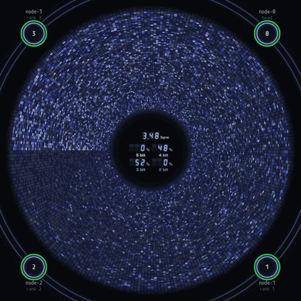

- **Decode**: the experts the model picks for each token light up and fade. This is real: the engine's log of its
  picks.
- **Prefill**: a ring moves out from the inside, marking the layer being computed (estimated from the prompt's progress).
  The twinkling of the cells is only a look.
- **Order**: while a prompt is computed the experts are in number order. Once the reply starts they turn to usage order,
  the most used first, from 9 o'clock.
- **The rim**: the prefill's progress while a prompt is computed (real). While decoding, the reply's text can run round
  the rim (Display, Text).
- **The centre**: bpw, the mean bits of the experts picked, and each width's share of the picks.
- **Thinking or answering**: while a reply thinks, the band round the rim takes one of the theme's colours and THINKING
  with its tokens shows above 12 o'clock; while it answers, the other colour and ANSWER. At the turn the new colour runs
  round from 12 o'clock.
- **On a ring lane** the four nodes stand round the circle, and the ring's lanes glow with their traffic.

### bpw and the speeds

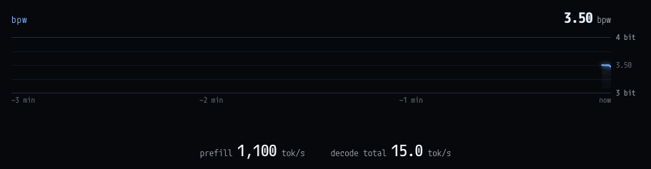

- **bpw**: the mean bits of the picked experts over the last 3 minutes.
- **prefill** and **decode** in tokens a second. With several conversations at once, decode is the total of all of them.

### [ NODE ] while running

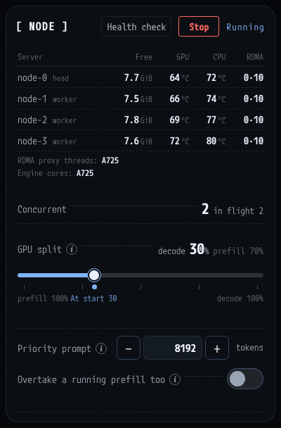

- **Health check**: sends the engine one request of about 1,000 tokens and judges the reply (below).
- **Stop**: stops the engine (below).
- **The servers**: each node with head or worker, its free memory, and its GPU and CPU temperatures, read every 5
  seconds. RDMA shows the CPUs of each node's two RoCE proxy threads (for example 0·10).
- **RDMA proxy threads** and **Engine cores**: where the proxy threads run (A725, X925, or left to the OS) and where
  the engine runs (A725, or left to the OS).
- **Concurrent**: the conversations the engine decodes together, and how many requests are in flight.
- **GPU split** (with Concurrent 2 or more): how the GPU's time is shared while a prompt is computed beside
  conversations that are decoding. From prefill 100% to decode 100%, in steps of 5. The dot is the start value.
- **Priority prompt**: a prompt with at most this many new tokens goes before longer ones. 0 turns it off.
- **Overtake a running prefill too**: a long prefill already running gives way to a priority prompt.

Each ⓘ opens what that row does.

### Health check

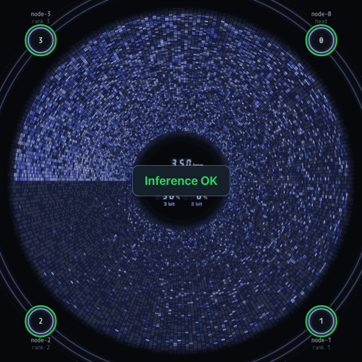

**Inference OK** shows over the centre for a few seconds when the reply is right. **Inference error** stays under the
button with its reason, until the next press or the engine stops. Behind a long request the check waits its turn, up to
600 seconds.

### [ REASONING CONTROL ]

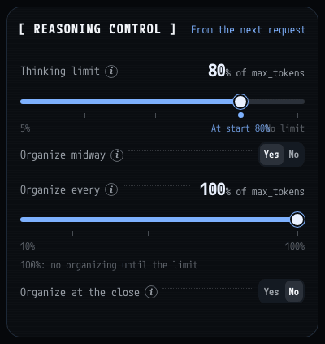

The thinking's settings, changed while the engine runs. A change takes the requests that start after it (the tag says
From the next request). It is also written to `glm53.conf`, so the next start keeps it.

- **Thinking limit**: 5% to 100% (No limit) of each reply's max_tokens. The dot is the start value.
- **Organize midway**: Yes or No.
- **Organize every**: 10% to 100% of max_tokens. 100% organizes only at the limit. Greyed when Organize midway is No.
- **Organize at the close**: Yes or No.

`FEATURES.md` says what each one does.

### [ RING ]

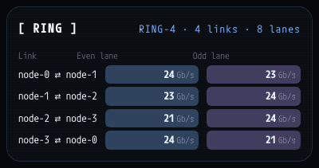

A ring lane only. Each link's even and odd lane, with the traffic it carries now in Gb/s, read about every 2 seconds. A
lane that is down says so.

### [ BIT ALLOC ] while running

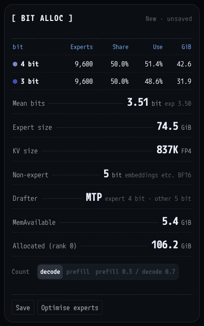

- **The head**: the allocation the start used (New · unsaved for a new plan).
- **The table**, one row a width loaded: Experts, Share (of the experts), Use (of this run's picks) and GiB.
- **Mean bits**: the mean bits of the picks; `exp` is the mean bits of the experts loaded.
- **Expert size**, **KV size** (tokens and format), **Non-expert**, **Drafter**, **MemAvailable** and **Allocated
  (rank 0)**.
- **Count**: which counts Use follows.
- **Save**: saves the bits loaded and the usage record under a name. **Optimise experts**: below.

### Optimise experts

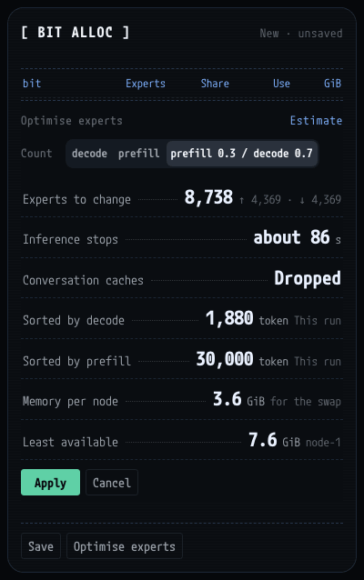

**Optimise experts** opens an estimate over the card:

- **Experts to change**: how many would change, and how many of them go up (↑) and down (↓) in bits.
- **Inference stops**: about how long the swap stops inference.
- **Conversation caches**: Dropped. The conversations kept in the KV pool are lost.
- **Sorted by decode** and **Sorted by prefill**: the tokens this run has counted.
- **Memory per node**: what each node needs for the swap, and the node with the least available.
- **Count** chooses which counts rank the experts. The estimate is taken again when you change it.

**Apply** waits until no request runs or waits, then swaps the experts layer by layer. **Cancel** closes it. The result
is not saved by itself: press Save to keep it.

### KV POOL

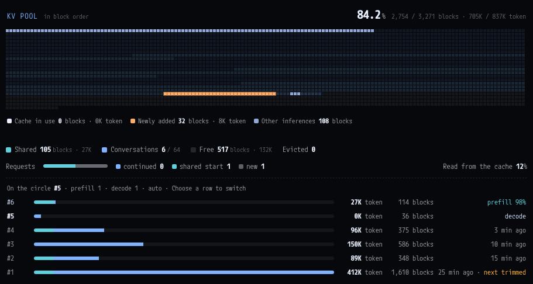

The KV cache that every conversation shares.

- **The head**: the share in use, the blocks used of all, and the tokens.
- **The map**: one cell a block of 256 positions. Teal: the shared start. Blue: the conversations kept. Dark: free.
  Over them, lit white: the cache the running request reads. Orange: the blocks it added. Blue-grey: other requests
  running now.
- **Shared**: blocks held by more than one conversation (a common system prompt, for example). **Conversations**: how
  many are kept, of 64. **Free** and **Evicted**.
- **Requests**: how requests used the cache (continued, shared start, new), and the share of prompt tokens read from
  the cache.
- **The conversations**: one row each, the most recently used first, with its tokens, blocks and state. The last row
  gives up its blocks first when room is needed (next trimmed). With several requests at once, choose a row to make the
  circle follow it.

### Stop

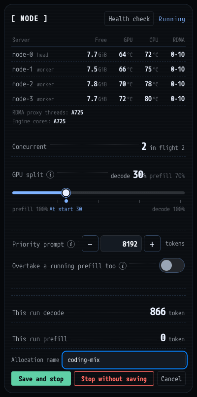

**Stop** asks first. It shows this run's decode and prefill tokens and an allocation name.

- **Save and stop**: saves the bits loaded and the usage record under that name, then stops.
- **Stop without saving**: stops and saves nothing.
- **Cancel**: keeps the engine running.

## Engine settings

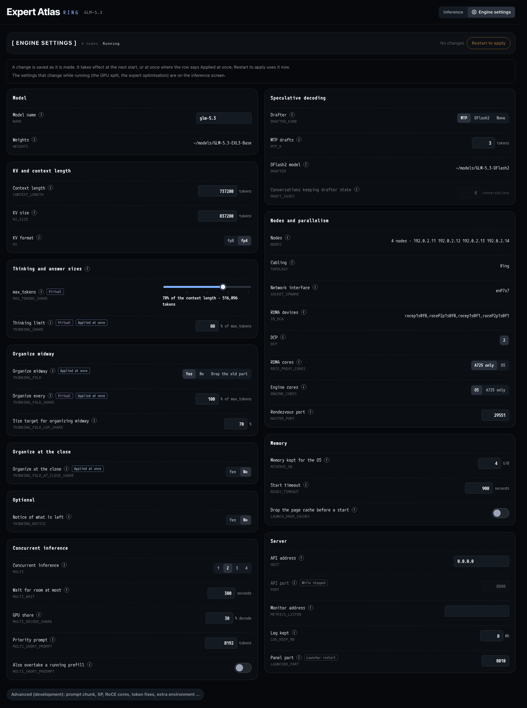

**Engine settings** in the header opens the settings that need a restart, in `glm53.conf`.

- **The head**: the node count, the engine's state, the changes waiting, and **Restart to apply** (while the engine
  runs).
- **The groups**: Model; KV and context length; Thinking and answer sizes; Organize midway; Organize at the close;
  Optional; Concurrent inference; Speculative decoding; Nodes and parallelism; Memory; Server.
- **Each row**: its name, an ⓘ, its key (for example `CONTEXT_LENGTH`) and its value. Tags say Applied at once, Virtual
  (counted on the tokens written), While stopped, or Launcher restart.
- **Advanced (development)** at the bottom: the prompt chunk, SP, the token fixes and extra environment settings.

A change is saved as you make it. It takes effect at the next start, or at once where the row says Applied at once.
**Restart to apply** restarts the engine now. It first asks whether to save this run's usage, as Stop does. The
weights and the nodes are shown here but changed in [ WEIGHTS ] and the node check.

## Display settings

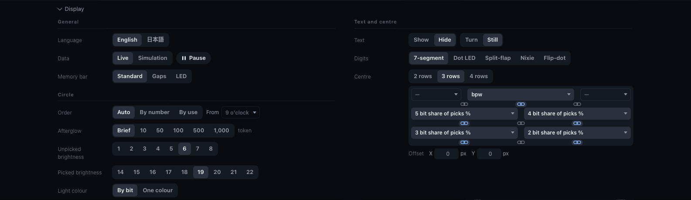

**Display** at the bottom opens this drawer. It changes how the panel looks, not the engine.

- **General**: Language (English or Japanese), Data (Live or Simulation, and Pause), and the memory bar's look.
- **Circle**: the order of the experts, how long a pick stays lit (Afterglow), the brightness of picked and unpicked
  experts, and the light's colour (By bit or One colour).
- **Text and centre**: the rim's text, the digits' style, and what the centre shows.
- **Colours**: the colour presets.
- **Back to defaults** (press it twice) at the bottom.

The settings are saved on the head node for the lane, so every browser shows the same panel.

## The circle hidden

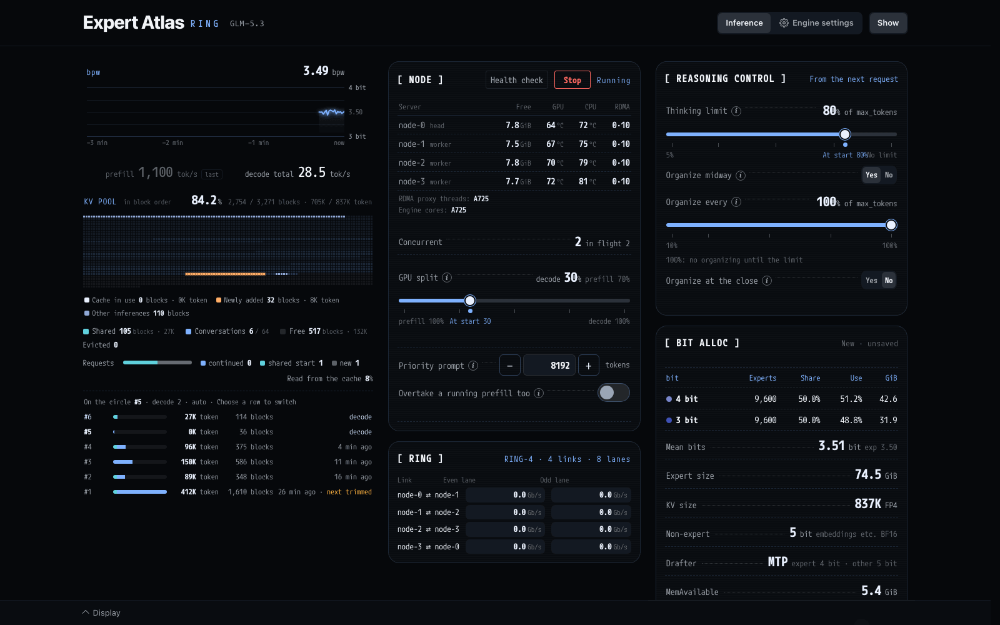

**Hide** in the header takes the circle away and stops drawing it. The cards then stand in columns: the bpw chart,
the speeds and the KV pool; [ NODE ] and [ RING ]; [ REASONING CONTROL ] and [ BIT ALLOC ]. **Show** brings the circle
back. The lane remembers the choice. This works on the launch screen too.
