[English](SCREENS.md) | [日本語](SCREENS.ja.md) | 简体中文

# Expert Atlas：界面说明

本页逐一介绍控制面板的每个界面，每个界面一节，附有截图，并说明其中各部分的含义。各功能的用途见 `FEATURES.zh-CN.md`，
每个控件的细节见 `PANEL-GUIDE.zh-CN.md`。

面板的界面语言只有英文和日文。本页使用英文界面的截图，并保留界面上的英文名称。

截图取自连接测试服务器的面板。其中的数字（内存、速度、token 数、温度）只是示例，不是实测值；你的节点会显示自己的数值。
节点以 node-0、node-1 等名称表示。

面板地址为 `http://<first node>:8010/panel`，即 `READY` 输出的仪表板地址（`QUICKSTART.zh-CN.md`）。面板没有密钥，请把节点放在封闭的网络中。

## 界面的顺序

| 步骤 | 界面 | 何时显示 |
|---|---|---|
| 1 | Node check（节点检查） | 尚未注册节点时，以及从步骤栏打开时 |
| 2 | Launch settings（启动设置） | 引擎停止时 |
| 3 | Start（启动） | 引擎载入时 |
| › | Live panel（运行面板） | 引擎运行时 |

面板会自行在这些界面之间切换。标题栏还可以打开两个界面：引擎设置和启动流程。显示设置是每个界面底部的抽屉。

标题栏包含：

- **步骤栏**（标题下方，仅在引擎运行之前）：每个步骤及其状态，例如 `RING-4` 或 `3.50 bit · Can start`。按下某一步即可打开对应界面。
- 标题旁的 **RING** 或 **SWITCH**：节点的连接方式。
- **Startup flow**：把各步骤汇总在一页上（见下文）。
- **Launch**（引擎运行时为 **Inference**）| **Engine settings**：在主界面和需要重启的设置之间切换。
- **Hide** / **Show**：隐藏或恢复圆。

## 1. 节点检查：环

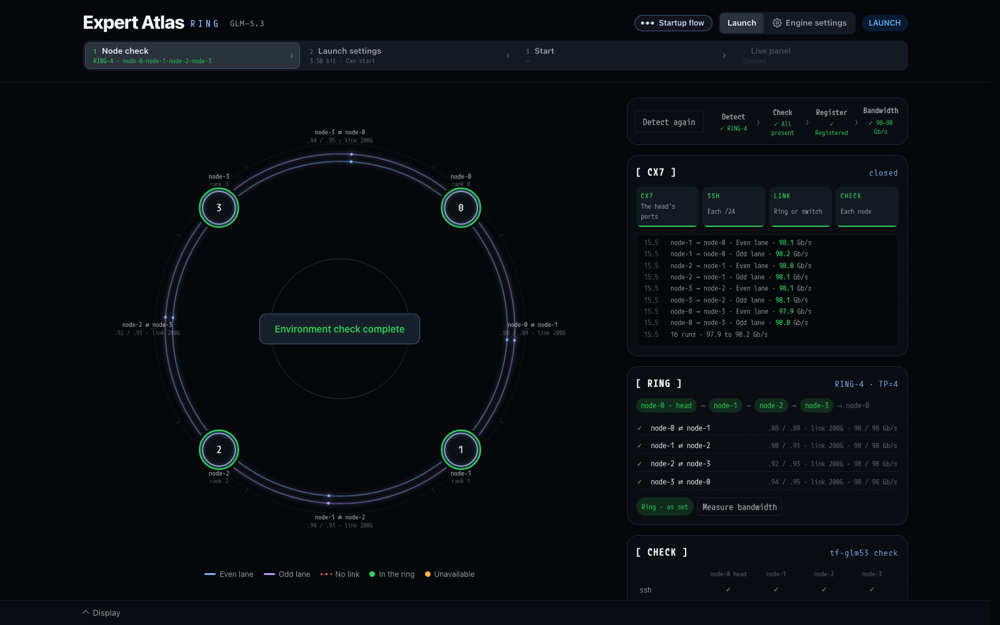

尚未注册节点时，面板在这里打开。在环上，面板打开时会读取 head 节点 ConnectX-7（CX7）的连线。

- **右上角的按钮**（Detect、Check the nodes，完成后为 Detect again）依次执行每个步骤：
  - **Detect**：通过 LLDP 沿连线逐个节点追踪，直到环闭合。
  - **Check**：在每个节点上运行 `tf-glm53 check`，缺少软件包的节点会先复制。
  - **Register**：按环的顺序把节点写入 `glm53.nodes.conf`。
  - **Bandwidth**：测量每条通道两个方向的带宽。

  每个步骤显示 ✓ 或 ✗ 以及简短的结果。某一步失败时，会停在那里并说明原因。
- **圆** 画出环。每个节点显示名称和 rank。每条链路有两条通道（内侧为偶数通道，外侧为奇数通道），并标出两个子网和链路速度。
  缺失的链路是红色虚线。所有步骤都通过时，中央显示 "Environment check complete"。
- **[ CX7 ]**：四个阶段（head 的端口、每个 /24 上的 SSH、环还是交换机、每个节点）以及各阶段发现内容的日志。带宽步骤之后，日志列出每条通道的 Gb/s。
- **[ RING ]**：从 head 开始的环的顺序，以及每条链路的子网、链路速度和测得的 Gb/s。**Measure bandwidth** 重新测量。
- **[ CHECK ]**：`tf-glm53 check` 的结果（见下文）。

所有步骤通过后，面板会进入启动设置。

### [ CHECK ]

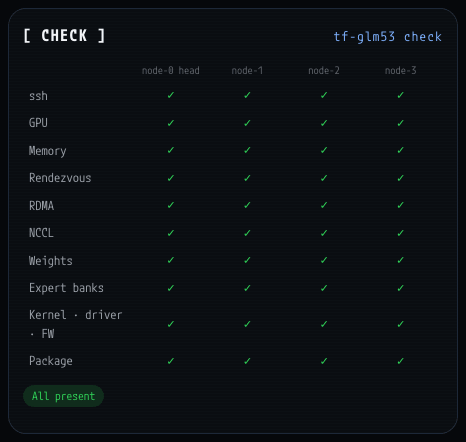

每列一个节点，每行一个检查项：ssh、GPU、内存、rendezvous、RDMA、NCCL、权重、专家 bank、内核·驱动·固件、软件包。✗ 会说明哪里有问题以及该怎么做。

## 1. 节点检查：交换机

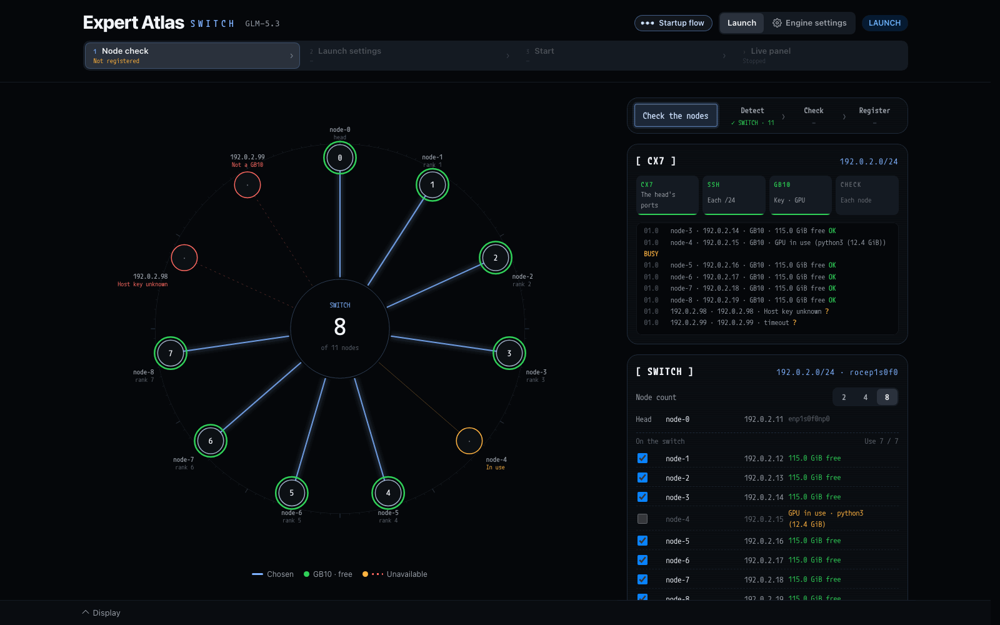

在交换机上，head 在自己的 ConnectX-7 /24 中寻找节点：能响应 ssh 的地址就是候选。

- **圆** 把找到的地址排在交换机周围。绿色是空闲的 GB10。每个选中的节点都有一条线连到中央。橙色表示正在使用（GPU 忙）。
  红色表示不能使用（不是 GB10、host key 未登记，或无响应）。中央显示在找到的节点中选中了几台。
- **[ CX7 ]**：每个地址一行日志，包括名称、空闲内存以及 OK、BUSY 或 ?。
- **[ SWITCH ]**：要使用的节点数、head，以及找到的所有节点和勾选框。正在使用的节点不能勾选。
- **Check the nodes** 检查勾选的节点并注册，与环相同。交换机没有带宽步骤。

如果交换机上还有其他人的节点，请先选择节点数和勾选，再按按钮（`PANEL-GUIDE.zh-CN.md`，“节点检查”）。

## 2. 启动设置

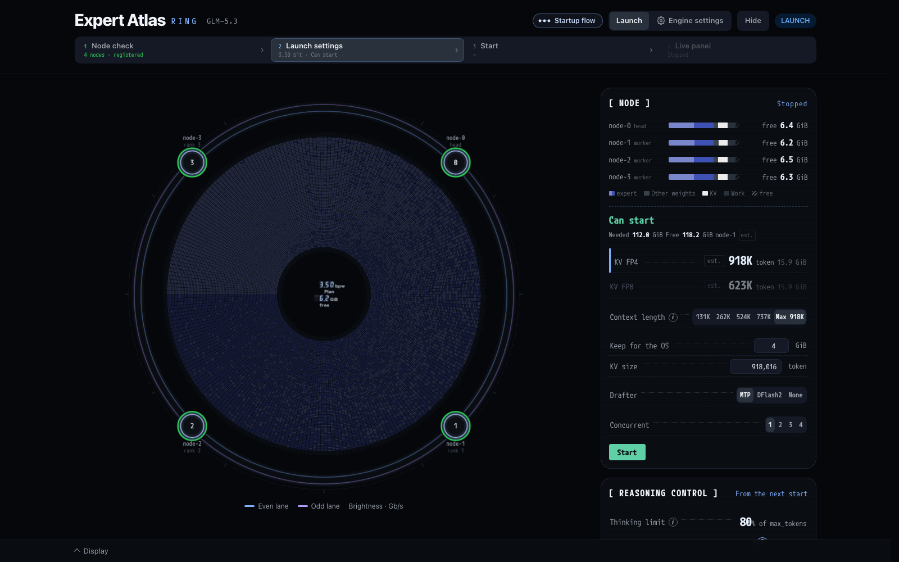

引擎处于停止状态。在这里规划下一次启动并按 Start。

- **圆** 显示计划：每个格子是 19,200 个路由专家中的一个，颜色表示其位宽。第 3 层在内侧，第 77 层在外侧，每圈 256 个专家。
  在环通道上，四个节点排列在圆的周围。
- **中央** 显示计划的平均位宽和空闲内存。
- **右侧的卡片**：[ NODE ]、[ REASONING CONTROL ]、[ WEIGHTS ]、[ BIT ALLOC ]，以及 **expert**（指向某个格子即可看到该专家在其层内的排名、被选中的比例、位宽和大小）。

### [ NODE ]：内存与启动

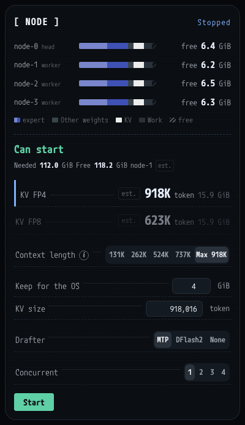

- **每个节点一条条形图**：计划占用的内存，分为 expert、Other weights、KV、Work 和 free。右侧是启动后剩余的 free GiB。
- **判定**：Can start、Can start (little room) 或 Not enough memory，并给出最紧张的节点所需和空闲的内存。`est.` 表示估算：启动器尚未在本通道上测量过使用该 drafter 的启动。
- **KV FP4 / KV FP8**：每种格式可得到的 KV 大小（token 数和每个节点的 GiB）。按下其一即选择该格式。
- **Context length**：最长的请求（prompt 与回复之和）。选择一个大小，或选择 Max（计划能容纳的最大值）。ⓘ 说明 Max 是如何得出的。
- **Keep for the OS**：启动后每个节点保留的空闲 GiB（2 至 32）。
- **KV size**：整个 KV 缓存容纳的 token 数。输入数字即可自行设定。
- **Drafter**：MTP、DFlash2 或 None。在每个节点都有其模型之前，DFlash2 呈灰色。
- **Concurrent**：一起 decode 的对话数，1 至 4。1 表示一次处理一个请求。
- **Start**：按下后，在 8 秒内按 Confirm。

这里的每个选择都会在选定时写入 `glm53.conf`。

### [ BIT ALLOC ]：每个专家的位宽

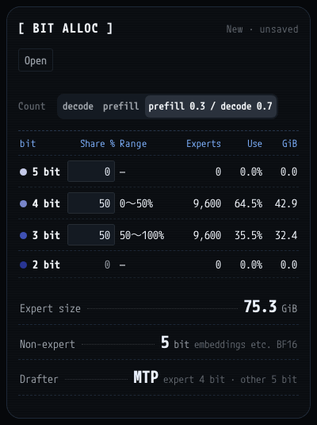

- **标题** 显示计划的名称：New · unsaved、上一次运行，或已保存分配的名称。
- **Open**：上一次运行的分配和已保存的分配（见下文）。
- **Count**（decode、prefill、prefill 0.3 / decode 0.7）：Use 列和圆的排列顺序所依据的次数。它不会改变计划的位宽。
- **表格** 每种位宽一行（5、4、3、2 bit）：Share %（为 5、4、3 bit 输入；有数据的最窄位宽占其余部分）、刻度上的范围（从 5 bit 一端开始）、
  Experts、Use（该位宽在被选中次数中所占比例）和 GiB。某个节点缺少 bank 的位宽显示 No data，不能分配比例。
- **Expert size**：路由专家占用的 GiB。**Non-expert** 和 **Drafter**：其他权重和 drafter 的位宽。

使用最多的专家得到最宽的位宽。输入比例即产生一个新计划。

### Open：已保存的分配

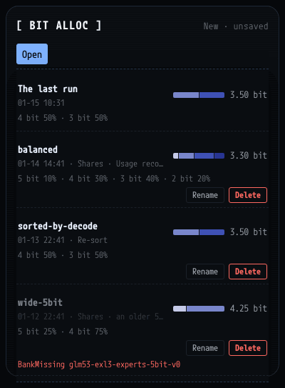

上一次运行的分配和每个已保存的分配，显示其制作时间和方式、比例以及平均位宽。按下其一即把它按位原样作为计划。已保存的分配可以 **Rename** 和
**Delete**（按两次）。需要本通道没有的 bank 的分配无法打开，原因以红色显示（此例为 `BankMissing`）。

### [ WEIGHTS ]：文件的位置

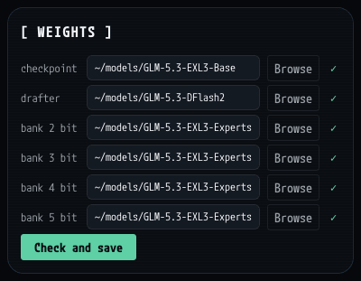

checkpoint、drafter（DFlash2）以及 2、3、4、5 bit 的 bank 各占一行。每一项都是一个目录，在每个节点上路径相同。**Browse** 在 head 上选择目录。
✓ 表示每个节点都有。**Check and save** 检查每个节点，通过后保存这些行。checkpoint 和 3 bit 的 bank 是必需的：缺少时该行变红，Start 无法按下。

### 启动前的 [ REASONING CONTROL ]

与运行面板上的卡片相同（第 4 节）。引擎停止时，其标签显示 From the next start：更改会保存在 `glm53.conf` 中，供下一次启动使用。

### Startup flow

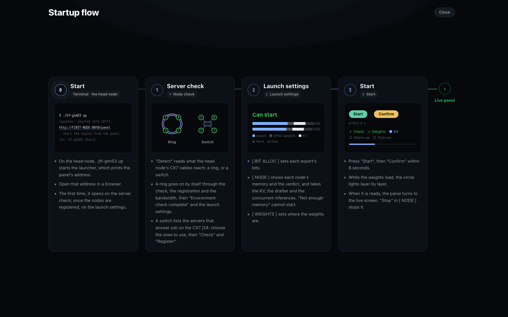

步骤栏显示时，标题栏的 **Startup flow** 会打开此页。它把各步骤放在一页上：0 在 head 节点启动启动器，1 节点检查，2 启动设置，3 启动，然后是运行面板。
**Close** 或 Escape 返回。

## 3. 启动

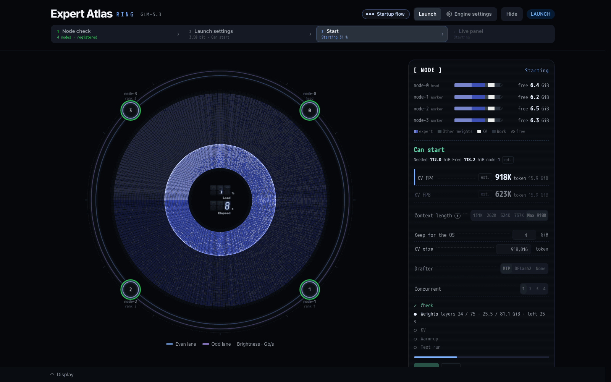

按下 Start 和 Confirm 后，步骤栏显示 Starting 和百分比。

- **圆** 随着每一层载入从内向外填满。这跟随引擎真实的载入进度。中央显示载入百分比和已用秒数。
- **[ NODE ]** 列出各阶段：Check、Weights（已载入的层数/75、GiB 和剩余时间）、KV、Warm-up 和 Test run，并有进度条。**Abort** 中止启动。

引擎就绪后，圆上方显示 "Start complete"、节点数和启动所用的秒数。随后页面切换到运行面板。

## 4. 运行面板

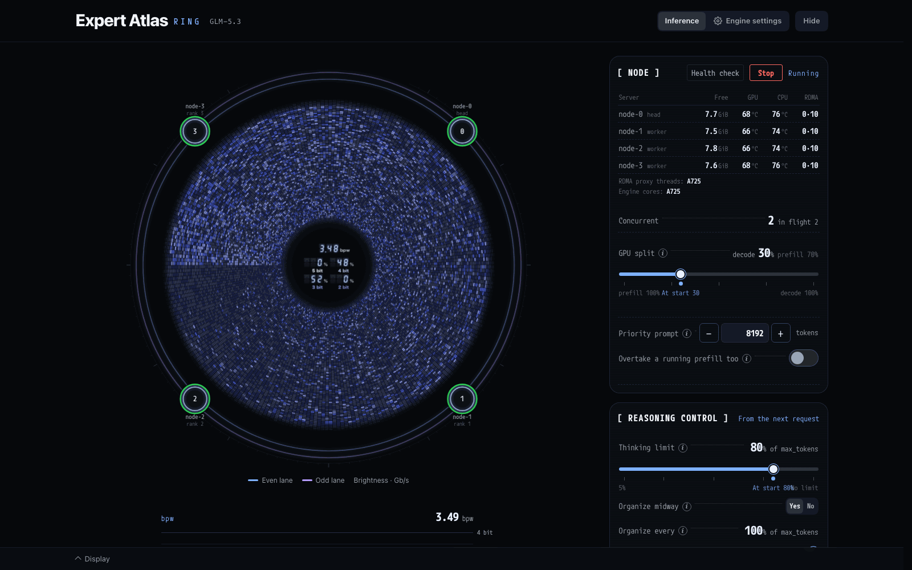

引擎正在运行。左侧的圆显示模型此刻在做什么。右侧的卡片显示节点以及运行时可以更改的设置。圆的下方是 bpw 图、速度和 KV pool。

### 圆

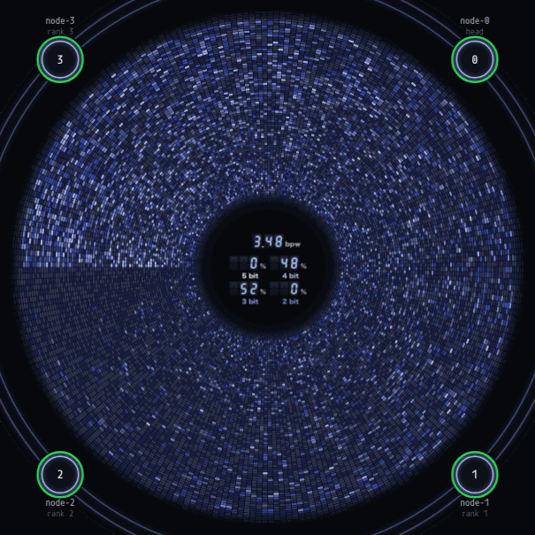

- **Decode**：模型为每个 token 选中的专家会亮起并渐暗。这是真实的：来自引擎的选择记录。
- **Prefill**：一个从内向外扩展的环标出正在计算的层（根据 prompt 的进度估算）。格子的闪烁只是视觉效果。
- **排列顺序**：计算 prompt 时专家按编号排列。回复开始后按使用顺序排列，使用最多的在前，从 9 点钟方向开始。
- **外圈**：计算 prompt 时显示 prefill 的进度（真实）。decode 时可以让回复的文字沿外圈滚动（Display 中的 Text）。
- **中央**：bpw（被选中专家的平均位宽）以及每种位宽在被选中次数中所占比例。
- **思考与回答**：回复思考期间，外圈的带使用主题的一种颜色，12 点钟方向上方显示 THINKING 及其 token 数；回答期间使用另一种颜色并显示 ANSWER。切换时，新颜色从 12 点钟方向绕一圈。
- **在环通道上**，四个节点排列在圆的周围，环的各条通道随其流量发亮。

### bpw 与速度

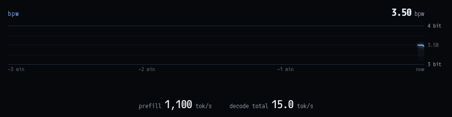

- **bpw**：最近 3 分钟内被选中专家的平均位宽。
- **prefill** 和 **decode**：每秒 token 数。同时有多个对话时，decode 为所有对话的总和。

### 运行时的 [ NODE ]

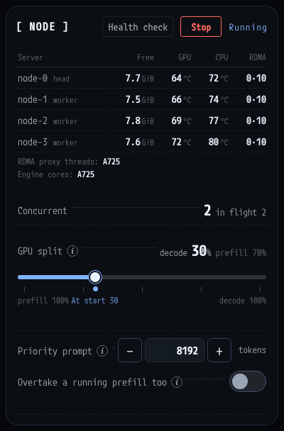

- **Health check**：向引擎发送一个约 1,000 token 的请求并判定回复（见下文）。
- **Stop**：停止引擎（见下文）。
- **服务器列表**：每个节点标明 head 或 worker，以及空闲内存、GPU 和 CPU 温度，每 5 秒读取一次。RDMA 列显示每个节点两个 RoCE 代理线程所在的 CPU（例如 0·10）。
- **RDMA proxy threads** 和 **Engine cores**：代理线程运行的位置（A725、X925，或交由操作系统）和引擎运行的位置（A725，或交由操作系统）。
- **Concurrent**：引擎一起 decode 的对话数，以及正在处理的请求数。
- **GPU split**（Concurrent 为 2 或以上时）：在 decode 中的对话旁边计算 prompt 时，GPU 时间如何分配。从 prefill 100% 到 decode 100%，步长为 5。圆点是启动时的值。
- **Priority prompt**：新 token 不超过此数的 prompt 会排在较长的 prompt 之前。0 表示关闭。
- **Overtake a running prefill too**：正在运行的长 prefill 也会让位给优先 prompt。

每个 ⓘ 会打开该行的说明。

### Health check

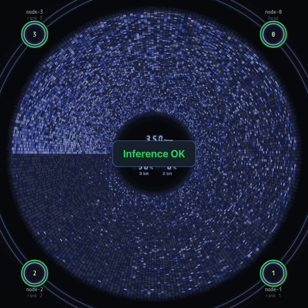

回复正确时，中央显示 **Inference OK** 几秒钟。**Inference error** 会连同原因留在按钮下方，直到再次按下或引擎停止。排在长请求之后时，检查会等待轮到自己，最多 600 秒。

### [ REASONING CONTROL ]

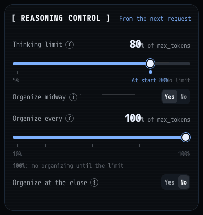

在引擎运行时更改思考的设置。更改对之后开始的请求生效（标签显示 From the next request）。更改也会写入 `glm53.conf`，因此下一次启动会保留。

- **Thinking limit**：每个回复的 max_tokens 的 5% 至 100%（No limit）。圆点是启动时的值。
- **Organize midway**：Yes 或 No。
- **Organize every**：max_tokens 的 10% 至 100%。100% 表示只在达到上限时整理。Organize midway 为 No 时呈灰色。
- **Organize at the close**：Yes 或 No。

各项的作用见 `FEATURES.zh-CN.md`。

### [ RING ]

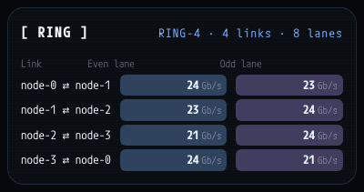

仅限环通道。每条链路的偶数和奇数通道，以及当前承载的流量（Gb/s），约每 2 秒读取一次。断开的通道会标明。

### 运行时的 [ BIT ALLOC ]

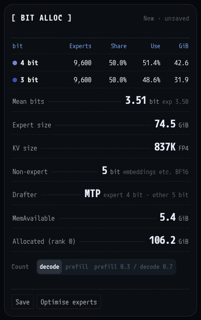

- **标题**：启动所用的分配（新计划为 New · unsaved）。
- **表格**：每种已载入的位宽一行：Experts、Share（占专家数的比例）、Use（占本次运行被选中次数的比例）和 GiB。
- **Mean bits**：被选中专家的平均位宽；`exp` 是已载入专家的平均位宽。
- **Expert size**、**KV size**（token 数和格式）、**Non-expert**、**Drafter**、**MemAvailable** 和 **Allocated (rank 0)**。
- **Count**：Use 所依据的次数。
- **Save**：以一个名称保存已载入的位宽和使用记录。**Optimise experts**：见下文。

### Optimise experts

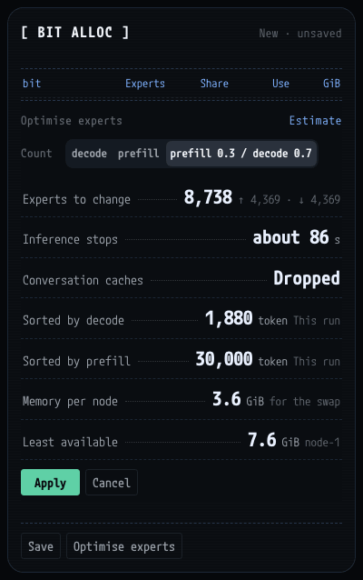

**Optimise experts** 在卡片上方打开一个估算：

- **Experts to change**：会改变的专家数，以及其中位宽升高（↑）和降低（↓）的数量。
- **Inference stops**：交换使推理停止的大致时间。
- **Conversation caches**：Dropped。KV pool 中保留的对话会丢失。
- **Sorted by decode** 和 **Sorted by prefill**：本次运行已统计的 token 数。
- **Memory per node**：每个节点交换所需的内存，以及可用内存最少的节点。
- **Count** 选择用哪种次数为专家排序。更改后会重新估算。

**Apply** 等到没有请求在运行或等待时，逐层交换专家。**Cancel** 关闭。结果不会自动保存：要保留请按 Save。

### KV POOL

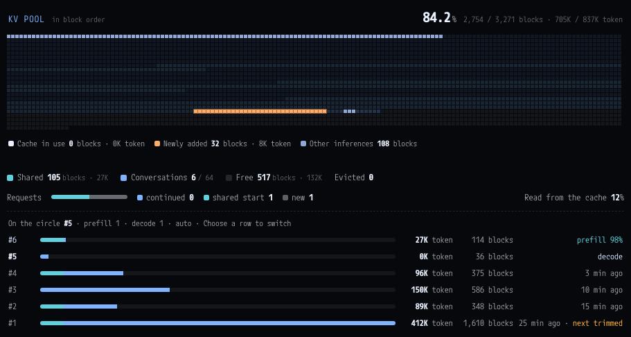

所有对话共享的 KV 缓存。

- **标题**：使用中的比例、已用块数与总块数，以及 token 数。
- **地图**：每个格子是一个 256 位置的块。青色是共享的开头，蓝色是保留的对话，暗色是空闲。其上，白色亮起的是正在运行的请求读取的缓存，橙色是它新增的块，蓝灰色是此刻在运行的其他请求。
- **Shared**：由多个对话共同持有的块（例如共同的 system prompt）。**Conversations**：保留的对话数，最多 64。**Free** 和 **Evicted**。
- **Requests**：请求如何使用缓存（continued、shared start、new），以及 prompt token 中从缓存读取的比例。
- **对话列表**：每个对话一行，最近使用的在前，显示其 token 数、块数和状态。需要空间时，最后一行最先交出它的块（next trimmed）。同时有多个请求时，选择一行即可让圆跟随该请求。

### Stop

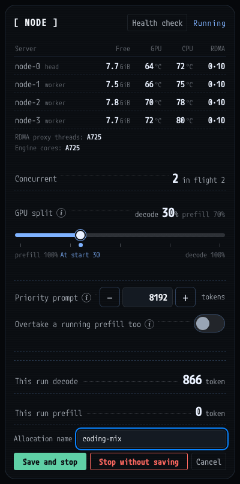

**Stop** 会先确认。它显示本次运行的 decode 和 prefill token 数以及分配名称。

- **Save and stop**：以该名称保存已载入的位宽和使用记录，然后停止。
- **Stop without saving**：停止，不保存任何内容。
- **Cancel**：让引擎继续运行。

## 引擎设置

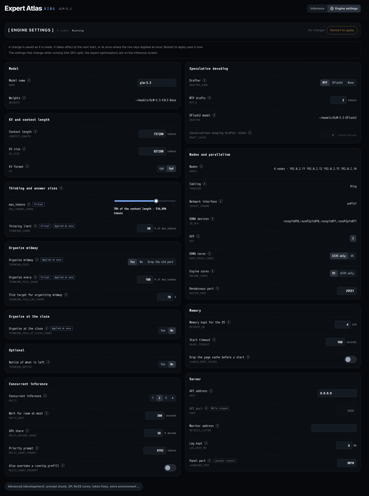

标题栏的 **Engine settings** 打开需要重启的设置，这些设置保存在 `glm53.conf` 中。

- **标题**：节点数、引擎状态、等待生效的更改，以及 **Restart to apply**（引擎运行时）。
- **分组**：Model；KV and context length；Thinking and answer sizes；Organize midway；Organize at the close；Optional；Concurrent inference；
  Speculative decoding；Nodes and parallelism；Memory；Server。
- **每一行**：名称、ⓘ、键（例如 `CONTEXT_LENGTH`）和值。标签有 Applied at once、Virtual（按写出的 token 计数）、While stopped 或 Launcher restart。
- 底部的 **Advanced (development)**：prompt 分块、SP、token 修正和额外的环境设置。

更改在做出时即保存。它在下一次启动时生效，标有 Applied at once 的行立即生效。**Restart to apply** 立即重启引擎；重启前会像 Stop 一样询问是否保存本次运行的使用记录。
权重和节点在这里只显示，要在 [ WEIGHTS ] 和节点检查中更改。

## 显示设置

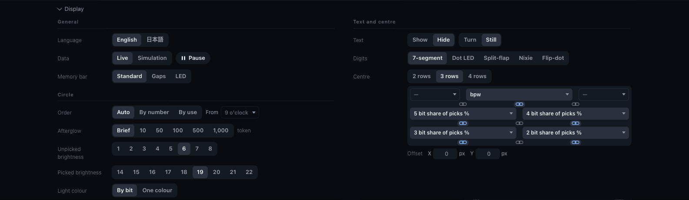

底部的 **Display** 打开此抽屉。它只改变面板的外观，不改变引擎。

- **General**：语言（English 或日文）、Data（Live 或 Simulation，以及 Pause）和内存条的样式。
- **Circle**：专家的排列顺序、选中后亮起的持续时间（Afterglow）、选中和未选中专家的亮度，以及光的颜色（By bit 或 One colour）。
- **Text and centre**：外圈的文字、数字的样式以及中央显示的内容。
- **Colours**：配色预设。
- 底部的 **Back to defaults**（按两次）。

这些设置按通道保存在 head 节点上，因此任何浏览器打开的面板都相同。

## 隐藏圆的界面

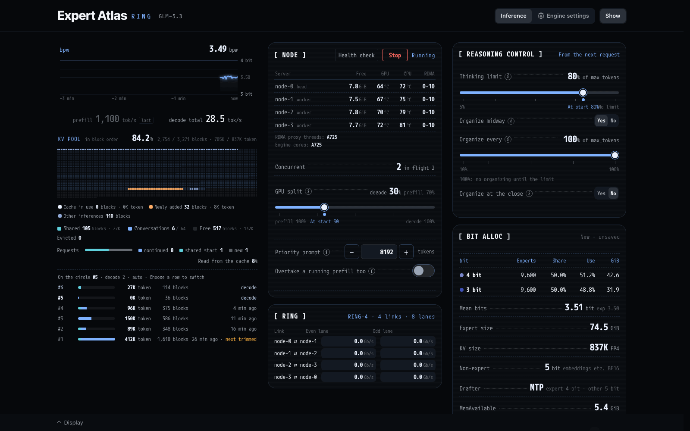

标题栏的 **Hide** 隐藏圆并停止绘制。卡片随后排成几列：bpw 图、速度和 KV pool；[ NODE ] 和 [ RING ]；[ REASONING CONTROL ] 和 [ BIT ALLOC ]。
**Show** 恢复圆。通道会记住这个选择。在启动界面上也可以使用。
